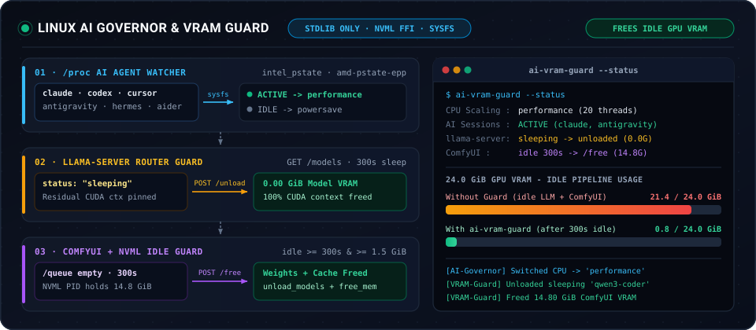

# Linux AI Governor & VRAM Guard (`linux-ai-vram-guard`)

<p align="center">
  
</p>

A lightweight, **zero-dependency** Python 3.10+ daemon for Linux AI workstations that automatically boosts CPU `cpufreq` governors during active AI coding agent sessions and reclaims **100% of idle GPU VRAM** from `llama.cpp` (`llama-server` router), `ComfyUI`, and `Ollama`.

---

## Why Does This Exist?

On 16 GB and 24 GB single-GPU workstations (such as RTX 3090 / 4090 / 5090 rigs shared across local LLMs, diffusion/video pipelines, and desktop apps), two subtle resource traps constantly collide:

1. **Sleeping Local LLMs & Idle Diffusion Pipelines Quietly Hoard CUDA Memory**
   - **`llama-server` Router Mode (`llama.cpp`):** Even when configured with `--sleep-idle-seconds 300`, models that transition to `status: "sleeping"` can retain gigabytes of residual CUDA context, KV-cache allocations, or backend memory pools — leaving less room than expected when another process suddenly needs 18–22 GiB of contiguous VRAM.
   - **`ComfyUI`:** After finishing a FLUX.1, SDXL, or Wan video generation workflow, `ComfyUI` keeps checkpoints, text encoders, VAEs, and PyTorch's CUDA caching allocator resident indefinitely until manually cleared or restarted — routinely pinning **12–20 GiB of VRAM** while its queue sits completely empty.
   - Result: launching a 32B quantized coding/reasoning model, Whisper transcription, or LoRA fine-tuning run fails immediately with `CUDA out of memory`.

2. **Linux CPU Governors Lag Interactive AI Agent Workflows**
   - Modern AI coding agents (`claude`, `codex`, `antigravity`, `hermes`, `aider`, `cursor`) execute rapid bursts of tool calls, ripgrep searches, AST parses, git diffs, test suites, and prompt tokenization.
   - Leaving all cores on `powersave` / `schedutil` introduces P-state ramp-up latency on bursty subprocess workloads — yet pinning `performance` 24/7 wastes idle package wattage when you close your editor for the night.

---

## How `ai-vram-guard` Solves Both Automatically

- **Dynamic AI Session CPU Governor (`intel_pstate`, `amd-pstate-epp`, `acpi-cpufreq`)**
  - Scans `/proc` directly in pure Python (zero `ps` subprocess forks!) for active AI coding agents.
  - Switches all `/sys/devices/system/cpu/cpu*/cpufreq/scaling_governor` threads to `performance` the moment a session starts, and drops cleanly back to `powersave` (on `intel_pstate` / `amd-pstate-epp` active hardware autonomous drivers) or `schedutil` (on passive `acpi-cpufreq` / `amd-pstate` kernels) once all sessions exit.
- **Zero-Residual `llama-server` Unload**
  - Polls `GET /models` on your `llama.cpp` router (`http://127.0.0.1:18436` by default, with optional `LLAMA_API_KEY` Bearer auth).
  - As soon as `llama-server` marks an inactive preset `"sleeping"`, `ai-vram-guard` issues `POST /models/unload` (`{"model": "<id>"}`) to release **100% of its CUDA allocation** back to the GPU driver. Pair `llama-server` with `--load-mode dio` on NVMe storage for sub-2-second cold reloads on your next prompt.
- **NVML + Socket-Aware `ComfyUI` Idle VRAM Reclaimer**
  - Binds directly to `libnvidia-ml.so.1` via Python's built-in `ctypes` FFI and maps listening socket inodes from `/proc/net/tcp{,6}` to exact GPU compute PIDs.
  - Only polls `ComfyUI`'s `GET /queue` when the `ComfyUI` process actually holds `>= 1.5 GiB` of GPU VRAM. Once the queue stays empty for `>= 300s` (5 minutes), it posts `{"unload_models": true, "free_memory": true}` to `POST /free` — evicting diffusion weights and flushing `torch.cuda.empty_cache()` automatically.
- **Optional `Ollama` Idle VRAM Reclaimer (`--ollama-url`)**
  - When `--ollama-url http://127.0.0.1:11434` (or `OLLAMA_URL`) is set, monitors `GET /api/ps` and evicts untouched resident models (`keep_alive: 0`) after `--idle-seconds`.
- **100% Pure Python Standard Library**
  - Zero `pip` packages, zero `venv` setup, `< 15 MB` RSS, and `< 2 ms` per 5-second poll cycle.

---

## Quick Start & Installation

### Requirements

- **Linux** (`x86_64` or `aarch64`) with **Python 3.10+**
- **NVIDIA Linux Driver** (`libnvidia-ml.so.1` for per-process GPU VRAM inspection; degrades gracefully on non-NVIDIA systems)

### 1. Install as a System Service (Recommended — CPU Governor + VRAM Guard)

```bash
git clone https://github.com/martynmcintee-tech/linux-ai-vram-guard.git
cd linux-ai-vram-guard
chmod +x install.sh
sudo ./install.sh
```

This installs:
- `/usr/local/bin/ai-vram-guard`
- `/etc/systemd/system/ai-vram-guard.service`
- `/etc/default/ai-vram-guard` (`0600` root-only environment config for optional overrides & `LLAMA_API_KEY`)

### 2. Rootless User Service (VRAM Guard Only, No `sudo`)

If you only want automatic GPU VRAM reclamation without root `sysfs` CPU governor writes:

```bash
./install.sh --user
```

### 3. Inspect Live Workstation Telemetry Anytime

```bash
# Human-readable telemetry snapshot
ai-vram-guard --status

# Machine-readable JSON telemetry
ai-vram-guard --status --json

# Dry-run a single check cycle without modifying governors or unloading models
ai-vram-guard --dry-run --once
```

Example `ai-vram-guard --status` output:

```text
Linux AI Governor & VRAM Guard v1.0.0
========================================================
CPU Scaling   : driver=intel_pstate | threads=20 | current=performance (active->performance, idle->powersave)
AI Sessions   : ACTIVE (claude[pid=14092], antigravity[24 procs, root_pid=17266])
GPU [0]       : NVIDIA GeForce RTX 3090 — 1.84 / 24.00 GiB VRAM used
CUDA Procs    : Xorg[1842]=0.42GiB, antigravity[17411]=0.38GiB
llama-server  : UP (http://127.0.0.1:18436) — unloaded: qwen3-coder-30b, deepseek-r1-32b
ComfyUI       : IDLE (http://127.0.0.1:8188) — VRAM=0.31 GiB (threshold=1.50 GiB, timeout=300s)
```

---

## Pairing with `llama-server` Router Mode

Run your `llama.cpp` multi-model router with `--sleep-idle-seconds 300`:

```bash
llama-server \
  --models-preset /path/to/presets.ini \
  --sleep-idle-seconds 300 \
  --host 127.0.0.1 --port 18436
```

After 5 minutes of LLM inactivity, `llama-server` transitions the active model to `"sleeping"`, and within 5 seconds `ai-vram-guard` calls `POST /models/unload` to drop GPU VRAM usage all the way to `0.00 GiB`.

If your `llama-server` uses `--api-key`, add `LLAMA_API_KEY=<your_token>` to `/etc/default/ai-vram-guard` and restart the service:

```bash
sudo systemctl restart ai-vram-guard.service
journalctl -u ai-vram-guard.service -f
```

---

## CLI Flags & Environment Variables

Every CLI option can also be configured via environment variables (ideal for `/etc/default/ai-vram-guard` or container setups):

| CLI Flag | Environment Variable | Default | Description |
| :--- | :--- | :--- | :--- |
| `--llama-url URL` | `LLAMA_URL` | `http://127.0.0.1:18436` | `llama-server` base URL (`off` to disable) |
| `--llama-api-key KEY` | `LLAMA_API_KEY` | *(empty)* | Optional Bearer token; `Authorization` header is only sent when non-empty |
| `--comfy-url URL` | `COMFY_URL` | `http://127.0.0.1:8188` | `ComfyUI` base URL (`off` to disable) |
| `--ollama-url URL` | `OLLAMA_URL` | *(empty)* | Optional `Ollama` base URL (e.g. `http://127.0.0.1:11434`) |
| `--idle-seconds SEC` | `AI_GUARD_IDLE_SECONDS` | `300` | Seconds of queue inactivity before freeing `ComfyUI` / `Ollama` VRAM |
| `--min-vram-gib GIB` | `AI_GUARD_MIN_VRAM_GIB` | `1.5` | Minimum `ComfyUI` GPU VRAM (GiB) required before triggering `/free` |
| `--poll-seconds SEC` | `AI_GUARD_POLL_SECONDS` | `5` | Daemon polling interval in seconds |
| `--watch-procs LIST` | `AI_GUARD_WATCH_PROCS` | `claude,codex,antigravity,hermes,aider,cursor` | Comma-separated AI agent process tokens that trigger CPU boost |
| `--active-governor GOV` | `AI_GUARD_ACTIVE_GOV` | `performance` | CPU governor applied while any watched AI agent is running |
| `--idle-governor GOV` | `AI_GUARD_IDLE_GOV` | `auto` | Idle CPU governor (`auto` picks `powersave` on `intel_pstate`/`amd-pstate-epp`, or `schedutil` on `acpi-cpufreq`) |
| `--no-governor` | `AI_GUARD_NO_GOVERNOR` | `false` | Disable CPU governor management (VRAM Guard only) |
| `--gpu-index IDX` | `AI_GUARD_GPU_INDEX` | `-1` | NVML GPU index (`0`, `1`, ...) or `-1` to aggregate across all NVIDIA GPUs |
| `--once` | — | `false` | Run one check cycle and exit |
| `--dry-run` | — | `false` | Log intended governor/VRAM actions without modifying `sysfs` or unloading models |
| `--status` | — | `false` | Print live CPU, AI session, NVML VRAM, and server status report, then exit |
| `--json` | — | `false` | Output JSON telemetry when combined with `--status` |

---

## Uninstalling

```bash
sudo ./install.sh --uninstall
# Or for a rootless user install:
./install.sh --uninstall
```

---

## License

Released under the [MIT License](LICENSE). Copyright (c) 2026 Martyn McIntee.
